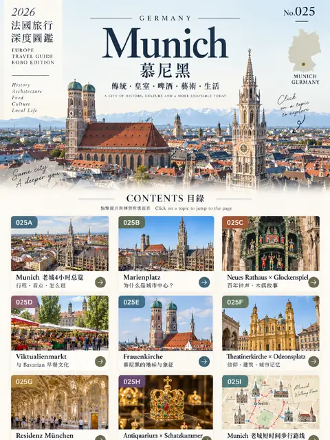

23 本 · 六个领域

# 私人百科图鉴

自己整理的深度图鉴，全部免费下载 PDF。

## 书架

移到或点一下书脊，封面展开

<button class="om-chip is-on" data-filter="all">全部</button><button class="om-chip" data-filter="new">最新上架</button><button class="om-chip" data-filter="身体">身体</button><button class="om-chip" data-filter="自然">自然</button><button class="om-chip" data-filter="科技">科技</button><button class="om-chip" data-filter="生活">生活</button><button class="om-chip" data-filter="北欧旅行百科">北欧旅行百科</button><button class="om-chip" data-filter="中国城市百科">中国城市百科</button><button class="om-chip" data-filter="法国城市百科">法国城市百科</button><button class="om-chip" data-filter="德国城市百科">德国城市百科</button><button class="om-chip" data-filter="瑞士城市百科">瑞士城市百科</button><button class="om-chip" data-filter="加拿大城市百科">加拿大城市百科</button><button class="om-chip" data-filter="加拿大主题图鉴">加拿大主题图鉴</button><button class="om-chip" data-filter="美国城市百科">美国城市百科</button>

<a class="om-spine__link" href="body/sleep/">

睡眠图鉴

</a>
<a class="om-spine__dl" href="https://github.com/littlesharkw/private-encyclopedias/releases/download/pdf-library/sleep.pdf">下载 PDF</a>

<a class="om-spine__link" href="nature/flowers/">

花的观察图鉴

</a>
<a class="om-spine__dl" href="https://github.com/littlesharkw/private-encyclopedias/releases/download/pdf-library/flowers.pdf">下载 PDF</a>

<a class="om-spine__link" href="tech/quantum/">

量子计算机图鉴

</a>
<a class="om-spine__dl" href="https://github.com/littlesharkw/private-encyclopedias/releases/download/pdf-library/quantum.pdf">下载 PDF</a>

<a class="om-spine__link" href="life/perfume/">

香水世界

</a>
<a class="om-spine__dl" href="https://github.com/littlesharkw/private-encyclopedias/releases/download/pdf-library/perfume.pdf">下载 PDF</a>

<a class="om-spine__link" href="world/europe/iceland/">

冰岛

</a>
<a class="om-spine__dl" href="https://github.com/littlesharkw/private-encyclopedias/releases/download/pdf-library/iceland.pdf">下载 PDF</a>

<a class="om-spine__link" href="world/asia/china/beijing/">

北京

</a>
<a class="om-spine__dl" href="https://github.com/littlesharkw/private-encyclopedias/releases/download/pdf-library/beijing.pdf">下载 PDF</a>

<a class="om-spine__link" href="world/europe/france/provence-alpes-cote-dazur/nice/">
005
尼斯

</a>
<a class="om-spine__dl" href="https://github.com/littlesharkw/private-encyclopedias/releases/download/pdf-library/nice.pdf">下载 PDF</a>

<a class="om-spine__link" href="world/europe/france/provence-alpes-cote-dazur/villefranche-sur-mer/">
012
滨海自由城

</a>
<a class="om-spine__dl" href="https://github.com/littlesharkw/private-encyclopedias/releases/download/pdf-library/villefranche-sur-mer.pdf">下载 PDF</a>

<a class="om-spine__link" href="world/europe/france/provence-alpes-cote-dazur/eze/">
013
埃兹

</a>
<a class="om-spine__dl" href="https://github.com/littlesharkw/private-encyclopedias/releases/download/pdf-library/eze.pdf">下载 PDF</a>

<a class="om-spine__link" href="world/europe/france/provence-alpes-cote-dazur/menton/">
015
芒通

</a>
<a class="om-spine__dl" href="https://github.com/littlesharkw/private-encyclopedias/releases/download/pdf-library/menton.pdf">下载 PDF</a>

<a class="om-spine__link" href="world/europe/france/provence-alpes-cote-dazur/cassis/">
023
卡西斯

</a>
<a class="om-spine__dl" href="https://github.com/littlesharkw/private-encyclopedias/releases/download/pdf-library/cassis.pdf">下载 PDF</a>

<a class="om-spine__link" href="world/europe/france/provence-alpes-cote-dazur/marseille/">
022
马赛

</a>
<a class="om-spine__dl" href="https://github.com/littlesharkw/private-encyclopedias/releases/download/pdf-library/marseille.pdf">下载 PDF</a>

<a class="om-spine__link" href="world/europe/france/provence-alpes-cote-dazur/avignon/">
018
阿维尼翁

</a>
<a class="om-spine__dl" href="https://github.com/littlesharkw/private-encyclopedias/releases/download/pdf-library/avignon.pdf">下载 PDF</a>

<a class="om-spine__link" href="world/europe/france/provence-alpes-cote-dazur/arles/">
016
阿尔勒

</a>
<a class="om-spine__dl" href="https://github.com/littlesharkw/private-encyclopedias/releases/download/pdf-library/arles.pdf">下载 PDF</a>

<a class="om-spine__link" href="world/europe/france/provence-alpes-cote-dazur/aix-en-provence/">
024
普罗旺斯艾克斯

</a>
<a class="om-spine__dl" href="https://github.com/littlesharkw/private-encyclopedias/releases/download/pdf-library/aix-en-provence.pdf">下载 PDF</a>

<a class="om-spine__link" href="world/europe/france/occitanie/nimes/">
026
尼姆

</a>
<a class="om-spine__dl" href="https://github.com/littlesharkw/private-encyclopedias/releases/download/pdf-library/nimes.pdf">下载 PDF</a>

<a class="om-spine__link" href="world/europe/france/auvergne-rhone-alpes/lyon/">
019
里昂

</a>
<a class="om-spine__dl" href="https://github.com/littlesharkw/private-encyclopedias/releases/download/pdf-library/lyon.pdf">下载 PDF</a>

<a class="om-spine__link" href="world/europe/monaco/">
014
摩纳哥

</a>
<a class="om-spine__dl" href="https://github.com/littlesharkw/private-encyclopedias/releases/download/pdf-library/monaco.pdf">下载 PDF</a>

<a class="om-spine__link" href="world/europe/switzerland/basel/">
001
巴塞尔

</a>
<a class="om-spine__dl" href="https://github.com/littlesharkw/private-encyclopedias/releases/download/pdf-library/basel.pdf">下载 PDF</a>

<a class="om-spine__link" href="world/europe/germany/munich/">
025
慕尼黑

</a>
<a class="om-spine__dl" href="https://github.com/littlesharkw/private-encyclopedias/releases/download/pdf-library/munich.pdf">下载 PDF</a>

<a class="om-spine__link" href="world/north-america/canada/ontario/woodstock/">

伍德斯托克

</a>
<a class="om-spine__dl" href="https://github.com/littlesharkw/private-encyclopedias/releases/download/pdf-library/woodstock.pdf">下载 PDF</a>

<a class="om-spine__link" href="world/north-america/canada/ontario/dairy-trail/">

安省鲜奶图鉴

</a>
<a class="om-spine__dl" href="https://github.com/littlesharkw/private-encyclopedias/releases/download/pdf-library/ontario-dairy.pdf">下载 PDF</a>

<a class="om-spine__link" href="world/north-america/usa/washington/seattle/">

西雅图

</a>
<a class="om-spine__dl" href="https://github.com/littlesharkw/private-encyclopedias/releases/download/pdf-library/seattle.pdf">下载 PDF</a>

最近 10 天没有新上架的图鉴。

[全部 PDF 列表](library.md) · [按主题查找](tags.md)

本系列为个人整理，不构成医疗、心理或法律专业意见。内容以 CC BY-NC 4.0 授权。

