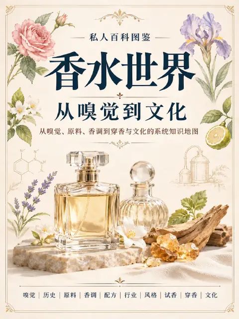

---
tags:
  - 生活
  - 香水
  - 文化
  - 历史
  - PDF下载
---

# 香水世界 · 从嗅觉到文化

生活

111 个主题（001–111）／10 个部分，另附录 A1–A4

[下载 PDF：香水世界 · 从嗅觉到文化](https://github.com/littlesharkw/private-encyclopedias/releases/download/pdf-library/perfume.pdf){ .md-button .md-button--primary }

## PDF 内容简介

从鼻子怎样闻到气味开始，一路讲到香水为什么会变成文化。前段是基础：嗅觉的机制、气味与记忆的关系、同一瓶香为什么在不同人身上不一样。接着是历史，由古埃及、阿拉伯蒸馏术、科隆之水，到合成香料如何催生现代香水。中段拆解原料与分子、香调与香调轮、配方浓度与留香，以及调香师这个行业怎样运作。后段回到日常：怎样试香、怎样挑适合自己的香、喷在哪里、怎样保存，最后谈香水背后的身份、价格、法规与伦理争议。

??? note "搜索关键词"

    嗅觉、嗅觉受体、气味与记忆、普鲁斯特效应、嗅觉疲劳、体温与皮肤、香水历史、古埃及、阿拉伯蒸馏、科隆之水、格拉斯、合成革命、天然香料、柑橘、玫瑰、茉莉、鸢尾花根、薰衣草、檀香木、雪松、香根草、沉香、乌木、香草、零陵香豆、树脂、动物香、龙涎香、麝香、Iso E Super、二氢茉莉酮酸甲酯、顶空技术、天然 vs 合成、香调轮、柑苔调、花香调、馥奇调、东方调、琥珀调、皮革调、美食调、淡香水、浓香精、留香、扩散、金字塔结构、熟成、重新调配、Reformulation、调香师、香精公司、法国香水传统、意大利、中东、东亚香水审美、试香纸、咖啡豆、一次试香流程、分装、旅行装、香水礼仪、喷法、叠香、保存方法、过期、IFRA 法规、动物实验、可持续

## 收录部分

- 前置 000 封面与使用方式
- 第一部分 认识气味（001–017）
- 第二部分 香水的历史（018–027）
- 第三部分 香料与分子（028–051）
- 第四部分 认识香调（052–063）
- 第五部分 配方与制作（064–073）
- 第六部分 调香师与产业（074–077）
- 第七部分 传统、地域与经典（078–081）
- 第八部分 试香与选择（082–091）
- 第九部分 穿香与保存（092–101）
- 第十部分 文化、产业与争议（102–111）
- 附录 A1–A4
