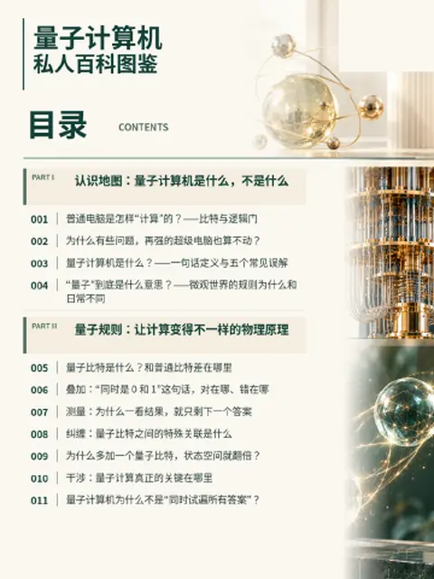

---
tags:
  - 科技
  - 物理
  - 计算机
  - PDF下载
---

# 量子计算机 · 私人百科图鉴

科技

51 个主题（001–051）／8 个部分

[📥 下载 PDF：量子计算机 · 私人百科图鉴（v1.0）](https://github.com/littlesharkw/private-encyclopedias/releases/download/pdf-library/quantum.pdf){ .md-button .md-button--primary }

## PDF 内容简介

先把量子计算机放回地图上：它是什么、不是什么，和普通电脑差在哪里。接着讲让计算变得不一样的物理原理，一次量子计算实际怎样进行，有哪些算法与能力边界，再谈造一台真机有多难、噪声为什么是最大的敌人。后半部分转向现实世界：密码与数字安全会受到什么冲击、量子通信与量子传感这些「计算之外」的技术，以及产业应用和普通人会在哪里真正感受到它。

**关键词**：量子比特、qubit、叠加、纠缠、干涉、测量、退相干、量子逻辑门、量子线路、量子算法、Shor 算法、Grover 搜索、量子优越性、量子霸权、噪声、量子纠错、NISQ、超导量子比特、离子阱、中性原子、光量子、拓扑、量子云、后量子密码、RSA、先存储后解密、量子通信、量子密钥分发、量子传感、量子模拟、药物研发、材料科学、金融优化、物流优化、量子计算与 AI

## 收录部分

- Part I 认识地图：量子计算机是什么，不是什么（001–004）
- Part II 量子规则：让计算变得不一样的物理原理（005–011）
- Part III 计算原理：量子计算机怎样解决问题（012–021）
- Part IV 硬件与工程：造一台量子计算机有多难（022–031）
- Part V 安全冲击：量子计算机与你的数字生活（032–037）
- Part VI 量子家族：计算之外的量子技术（038–040）
- Part VII 产业应用：量子计算会改变哪些行业（041–048）
- Part VIII 日常生活：普通人会在哪里感受到量子（049–051）
