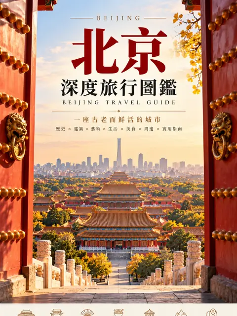

---
tags:
  - 旅行
  - 亚洲
  - 中国城市百科
  - 历史
  - 建筑
  - 世界遗产
  - 博物馆
  - 美食
  - 花园
  - PDF下载
---

# 北京

位置：世界 › 亚洲 › 中国 › **北京**

中国城市百科

288 个主题（001–288）／17 篇

[下载 PDF：中国城市百科 · 北京](https://github.com/littlesharkw/private-encyclopedias/releases/download/pdf-library/beijing.pdf){ .md-button .md-button--primary }

## PDF 内容简介

一本把三千年城市史摊开来读的北京图鉴。先从「北京为什么在这里」讲起，再逐层拆解紫禁城、中轴线、胡同与四合院，接着走进王府寺庙、皇家园林、长城与十三陵，看博物馆里的中国。后半转向近代与当代：城墙为什么消失、梁思成的反对、从工厂到艺术区的 798、国贸 CBD 与海淀东城的差别。最后是吃、是人、是京剧，以及一套可以照着走的 21 天路线和现场观察方法。

??? note "搜索关键词"

    燕京、金中都、元大都、方形城市、内城外城皇城、中轴线、紫禁城、故宫、太和殿、琉璃瓦、天安门、景山、鼓楼钟楼、前门大栅栏、胡同、四合院、门墩、南锣鼓巷、国子监、孔庙、雍和宫、恭王府、白云观、法源寺、妙应寺白塔、北海、颐和园、圆明园、避暑山庄、清东陵、长城、八达岭、慕田峪、金山岭、箭扣、十三陵、定陵、神道、国家博物馆、首都博物馆、中国美术馆、圆明园劫掠、义和团、八国联军、新文化运动、北平、梁思成、人民大会堂、国家大剧院、鸟巢、水立方、798、国贸 CBD、三里屯、海淀、北京烤鸭、焖炉挂炉、铜锅涮肉、炸酱面、豆汁儿、卤煮、爆肚、驴打滚、艾窝窝、豌豆黄、京味儿、遛鸟、澡堂、茶馆、京剧、脸谱、梅兰芳、相声、评书、天桥、承德、外八庙、天津租界、21 天路线

## 收录篇章

- 第一篇 先读懂北京（001–018）
- 第二篇 紫禁城：走进皇权世界（019–058）
- 第三篇 北京中轴线（059–078）
- 第四篇 胡同与四合院（079–104）
- 第五篇 王府、寺庙与宗教（105–119）
- 第六篇 皇家园林（120–138）
- 第七篇 长城与北京防御体系（139–150）
- 第八篇 十三陵与皇帝死亡世界（151–157）
- 第九篇 博物馆北京（158–167）
- 第十篇 近代北京（168–176）
- 第十一篇 现代北京（177–190）
- 第十二篇 吃懂北京（191–210）
- 第十三篇 北京人的生活（211–224）
- 第十四篇 京剧与传统娱乐（225–234）
- 第十五篇 三周才值得做的周边（235–243）
- 第十六篇 现场观察型图鉴（244–256）
- 第十七篇 21 天旅行路线（257–288）

!!! info "信息时效"
    交通、价格和开放时间可能会变动，出发前请再次核实。
