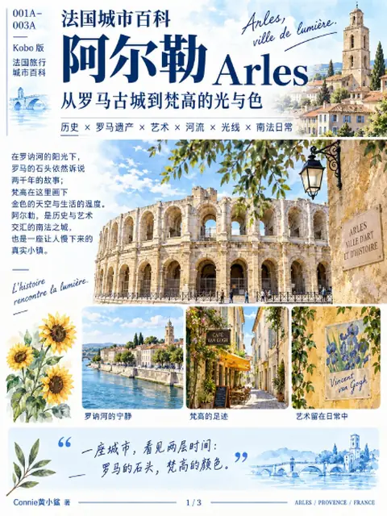
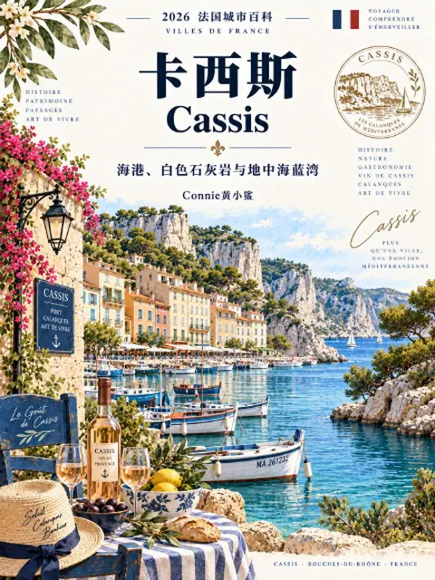
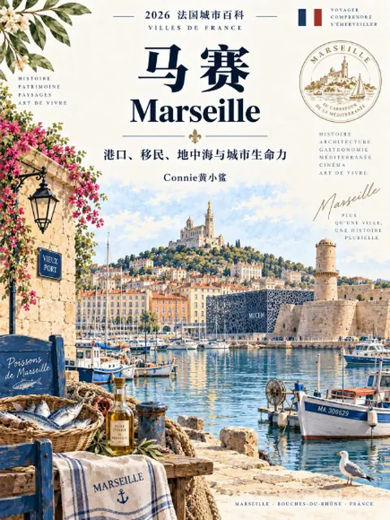
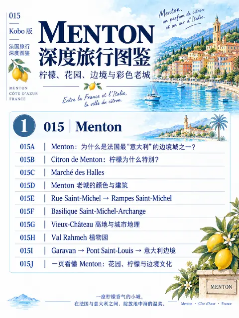
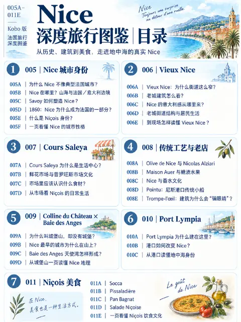
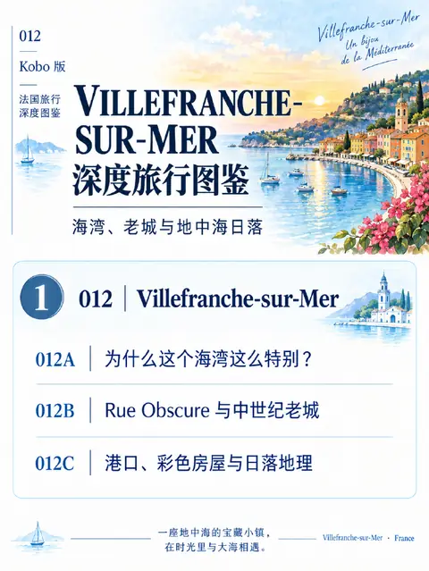

---
tags:
  - 旅行
  - 欧洲
---

# 法国

位置：世界 › 欧洲 › **法国**

11 本可下载的图鉴

<a class="om-book__link" href="auvergne-rhone-alpes/lyon/">

奥弗涅-罗讷-阿尔卑斯大区
里昂 Lyon
</a>

<a class="om-book__link" href="occitanie/nimes/">

奥克西塔尼大区
尼姆 Nîmes
</a>

<a class="om-book__link" href="provence-alpes-cote-dazur/aix-en-provence/">

普罗旺斯-阿尔卑斯-蓝色海岸大区
普罗旺斯艾克斯 Aix-en-Provence
</a>

<a class="om-book__link" href="provence-alpes-cote-dazur/arles/">

普罗旺斯-阿尔卑斯-蓝色海岸大区
阿尔勒 Arles
</a>

<a class="om-book__link" href="provence-alpes-cote-dazur/avignon/">

普罗旺斯-阿尔卑斯-蓝色海岸大区
阿维尼翁 Avignon
</a>

<a class="om-book__link" href="provence-alpes-cote-dazur/cassis/">

普罗旺斯-阿尔卑斯-蓝色海岸大区
卡西斯 Cassis
</a>

<a class="om-book__link" href="provence-alpes-cote-dazur/eze/">

普罗旺斯-阿尔卑斯-蓝色海岸大区
埃兹 Èze
</a>

<a class="om-book__link" href="provence-alpes-cote-dazur/marseille/">

普罗旺斯-阿尔卑斯-蓝色海岸大区
马赛 Marseille
</a>

<a class="om-book__link" href="provence-alpes-cote-dazur/menton/">

普罗旺斯-阿尔卑斯-蓝色海岸大区
芒通 Menton
</a>

<a class="om-book__link" href="provence-alpes-cote-dazur/nice/">

普罗旺斯-阿尔卑斯-蓝色海岸大区
尼斯 Nice
</a>

<a class="om-book__link" href="provence-alpes-cote-dazur/villefranche-sur-mer/">

普罗旺斯-阿尔卑斯-蓝色海岸大区
滨海自由城 Villefranche-sur-Mer
</a>

下一层：[普罗旺斯-阿尔卑斯-蓝色海岸大区](provence-alpes-cote-dazur/)、[奥弗涅-罗讷-阿尔卑斯大区](auvergne-rhone-alpes/)、[奥克西塔尼大区](occitanie/)

