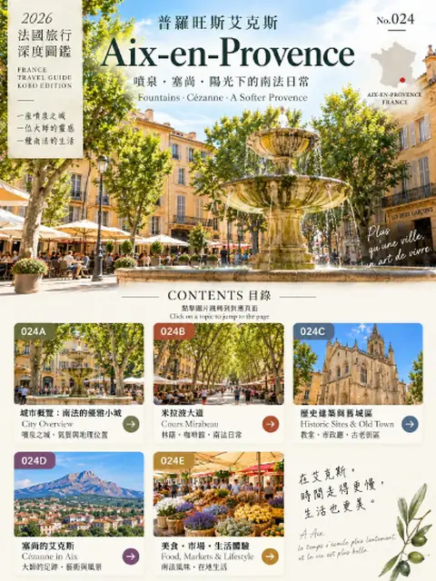

---
tags:
  - 旅行
  - 欧洲
  - 法国城市百科
  - 老城
  - 艺术
  - 市集
  - 美食
  - PDF下载
---

# 普罗旺斯艾克斯 Aix-en-Provence

位置：世界 › 欧洲 › 法国 › 普罗旺斯-阿尔卑斯-蓝色海岸大区 › **普罗旺斯艾克斯 Aix-en-Provence**

| 项目 | 内容 |
|---|---|
| 层级 | 城市 |
| 系列 | 法国城市百科 |
| 格式 | PDF |
| 状态 | ✅ 可下载 |

[📥 下载 PDF：法国城市百科 · 普罗旺斯艾克斯 Aix-en-Provence](https://github.com/littlesharkw/private-encyclopedias/releases/download/pdf-library/aix-en-provence.pdf){ .md-button .md-button--primary }

## PDF 内容简介

艾克斯是普罗旺斯的艺术之都，也被称为「千泉之城」。本册从城市的地质与泉水讲起，解释水如何塑造了这座城的历史与气质，再走过米拉波大道、老城巷弄与普罗旺斯市集，看塞尚在这里留下的痕迹，最后谈这座城市的饮食与慢下来的生活方式。

**关键词**：千泉之城、Aquae Sextiae、罗马温泉、泉水、喷泉、Cours Mirabeau、米拉波大道、La Rotonde、Fontaine de la Rotonde、Mirabeau、老城、Place Richelme 市集、Hôtel de Ville、钟楼、Sainte-Victoire 圣维克多山、塞尚 Cézanne、画室、普罗旺斯生活、橄榄油、薰衣草、香皂、Calisson

## 收录章节

- 024A 城市概览：初遇艾克斯
- 024B Cours Mirabeau 米拉波大道
- 024C 老城、市场与普罗旺斯生活
- 024D 塞尚的艾克斯
- 024E 美食、市集与生活品鉴

!!! info "信息时效"
    交通、价格和开放时间可能会变动，出发前请再次核实。
