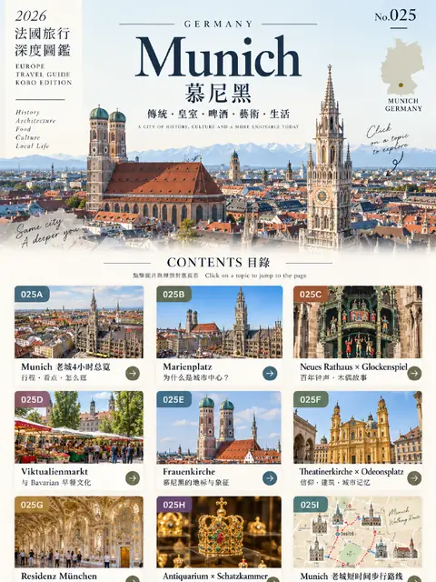

---
tags:
  - 旅行
  - 欧洲
  - 德国城市百科
  - 老城
  - 历史
  - 建筑
  - 教堂
  - 市集
  - 美食
  - 王室
  - PDF下载
---

# 慕尼黑 Munich

位置：世界 › 欧洲 › 德国 › **慕尼黑 Munich**

德国城市百科

9 个主题（025A–025I）

[📥 下载 PDF：德国城市百科 · 慕尼黑 Munich](https://github.com/littlesharkw/private-encyclopedias/releases/download/pdf-library/munich.pdf){ .md-button .md-button--primary }

## PDF 内容简介

一条四小时的老城精华路线，读懂巴伐利亚的历史、建筑与生活方式。从玛利亚广场为什么成为城市中心讲起，看新市政厅的木偶报时钟、圣母教堂的双圆顶、谷物市场的巴伐利亚早餐，再走进维特尔斯巴赫王朝的王宫与珍宝馆，最后附一张老城步行路线图与实用建议。

**关键词**：Marienplatz 玛利亚广场、圣母玛利亚柱 Mariensäule、三十年战争、Neues Rathaus 新市政厅、Glockenspiel 木偶报时钟、Frauenkirche 圣母教堂、双圆顶、Viktualienmarkt 谷物市场、白香肠、椒盐卷饼、啤酒花园、Bavarian 早餐、Theatinerkirche、Odeonsplatz 王宫广场、巴洛克、Residenz München 王宫博物馆、Wittelsbach 维特尔斯巴赫、Antiquarium、Schatzkammer 珍宝馆、Altstadt 老城、Kaufingerstraße、S-Bahn、U-Bahn、老城步行路线

## 收录章节

- 025A Munich 老城 4 小时总览
- 025B Marienplatz：为什么是城市中心
- 025C Neues Rathaus × Glockenspiel：百年钟声与木偶故事
- 025D Viktualienmarkt 与 Bavarian 早餐文化
- 025E Frauenkirche：慕尼黑的地标与象征
- 025F Theatinerkirche × Odeonsplatz：信仰、建筑与城市记忆
- 025G Residenz München：Wittelsbach 的皇室世界
- 025H Antiquarium × Schatzkammer：艺术、珍宝与权力
- 025I Munich 老城短时步行路线

!!! info "信息时效"
    交通、价格和开放时间可能会变动，出发前请再次核实。
