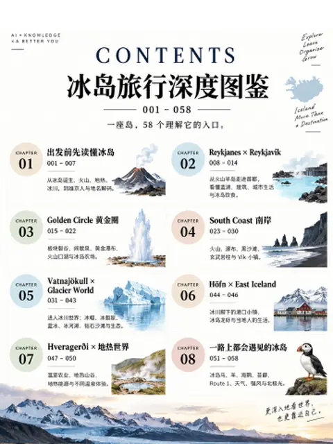
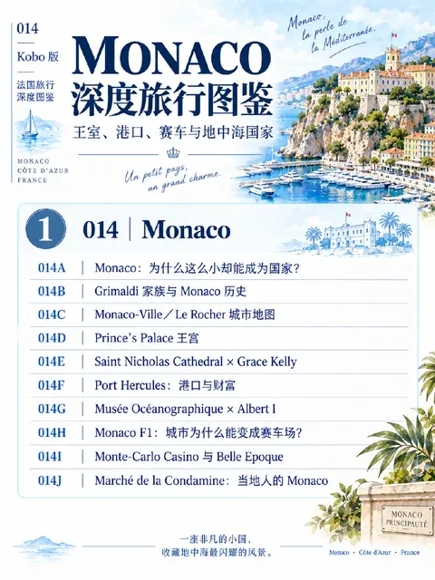
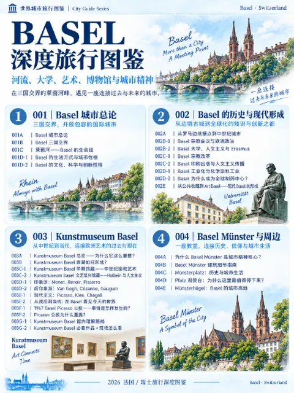

---
tags:
  - 旅行
---

# 世界 · 深度旅行图鉴

16 本可下载的图鉴

<a class="om-book__link" href="europe/france/auvergne-rhone-alpes/lyon/">

欧洲 › 法国 › 奥弗涅-罗讷-阿尔卑斯大区
里昂 Lyon
</a>

<a class="om-book__link" href="europe/france/occitanie/nimes/">

欧洲 › 法国 › 奥克西塔尼大区
尼姆 Nîmes
</a>

<a class="om-book__link" href="europe/france/provence-alpes-cote-dazur/aix-en-provence/">

欧洲 › 法国 › 普罗旺斯-阿尔卑斯-蓝色海岸大区
普罗旺斯艾克斯 Aix-en-Provence
</a>

<a class="om-book__link" href="europe/france/provence-alpes-cote-dazur/arles/">

欧洲 › 法国 › 普罗旺斯-阿尔卑斯-蓝色海岸大区
阿尔勒 Arles
</a>

<a class="om-book__link" href="europe/france/provence-alpes-cote-dazur/avignon/">

欧洲 › 法国 › 普罗旺斯-阿尔卑斯-蓝色海岸大区
阿维尼翁 Avignon
</a>

<a class="om-book__link" href="europe/france/provence-alpes-cote-dazur/cassis/">

欧洲 › 法国 › 普罗旺斯-阿尔卑斯-蓝色海岸大区
卡西斯 Cassis
</a>

<a class="om-book__link" href="europe/france/provence-alpes-cote-dazur/eze/">

欧洲 › 法国 › 普罗旺斯-阿尔卑斯-蓝色海岸大区
埃兹 Èze
</a>

<a class="om-book__link" href="europe/france/provence-alpes-cote-dazur/marseille/">

欧洲 › 法国 › 普罗旺斯-阿尔卑斯-蓝色海岸大区
马赛 Marseille
</a>

<a class="om-book__link" href="europe/france/provence-alpes-cote-dazur/menton/">

欧洲 › 法国 › 普罗旺斯-阿尔卑斯-蓝色海岸大区
芒通 Menton
</a>

<a class="om-book__link" href="europe/france/provence-alpes-cote-dazur/nice/">

欧洲 › 法国 › 普罗旺斯-阿尔卑斯-蓝色海岸大区
尼斯 Nice
</a>

<a class="om-book__link" href="europe/france/provence-alpes-cote-dazur/villefranche-sur-mer/">

欧洲 › 法国 › 普罗旺斯-阿尔卑斯-蓝色海岸大区
滨海自由城 Villefranche-sur-Mer
</a>

<a class="om-book__link" href="europe/iceland/">

欧洲
冰岛
</a>

<a class="om-book__link" href="europe/monaco/">

欧洲
摩纳哥 Monaco
</a>

<a class="om-book__link" href="europe/switzerland/basel/">

欧洲 › 瑞士
巴塞尔 Basel
</a>

<a class="om-book__link" href="north-america/canada/ontario/dairy-trail/">

北美洲 › 加拿大 › 安大略省
安省鲜奶图鉴
</a>

<a class="om-book__link" href="north-america/canada/ontario/woodstock/">

北美洲 › 加拿大 › 安大略省
伍德斯托克 Woodstock
</a>

按洲浏览：[北美洲](north-america/)、[亚洲](asia/)、[欧洲](europe/)

