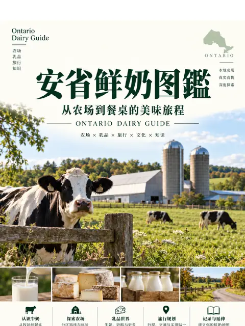

---
tags:
  - 旅行
  - 北美洲
---

# 北美洲

位置：世界 › **北美洲**

2 本可下载的图鉴

<a class="om-book__link" href="canada/ontario/dairy-trail/">

加拿大 › 安大略省
安省鲜奶图鉴
</a>

<a class="om-book__link" href="canada/ontario/woodstock/">

加拿大 › 安大略省
伍德斯托克 Woodstock
</a>

下一层：[加拿大](canada/)

