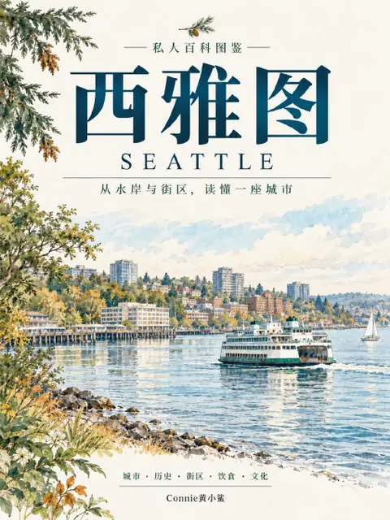

---
tags:
  - 旅行
  - 北美洲
  - 美国城市百科
  - 海景
  - 历史
  - 美食
  - 市集
  - 艺术
  - 自然
  - PDF下载
---

# 西雅图 Seattle

位置：世界 › 北美洲 › 美国 › 华盛顿州 › **西雅图 Seattle**

美国城市百科

75 个主题（001–075）／8 章

[📥 下载 PDF：美国城市百科 · 西雅图 Seattle](https://github.com/littlesharkw/private-encyclopedias/releases/download/pdf-library/seattle.pdf){ .md-button .md-button--primary }

## PDF 内容简介

从水岸与街区读懂一座被水与山包围的城市。先讲地理与气候——西雅图到底是不是总在下雨，再从 Coast Salish 原住民、Denny Party 登陆、1889 大火与地下城、淘金热、世博会与太空针，一路讲到 Grunge 年代和微软、亚马逊带来的科技之城。中段逐个走遍派克市场、先锋广场、国际区、Capitol Hill、Fremont、Ballard，再出城去渡轮、雷尼尔山与 Leavenworth。最后谈咖啡、海鲜、精酿、音乐与公共艺术，以及移民故事、雨天哲学与这座城市今天面对的房价与无家者问题。

**关键词**：Coast Salish、Chief Seattle、Denny Party、Alki Point、1889 大火、地下城、Denny Regrade、克朗代克淘金热、1962 世博会、Space Needle、Grunge、Nirvana、Pearl Jam、Jimi Hendrix、微软、Amazon、South Lake Union、Amazon Spheres、Pike Place Market、Gum Wall、Post Alley、第一家星巴克、Starbucks Reserve Roastery、Waterfront Park、Seattle Center、Chihuly Garden and Glass、MoPOP、Kerry Park、Pioneer Square、Smith Tower、Chinatown-International District、Capitol Hill、Fremont Troll、Gas Works Park、Ballard Locks、三文鱼梯、Museum of Flight、华盛顿州渡轮、Bainbridge Island、Alki Beach、Lake Union 船屋、水上飞机、Mount Rainier、Snoqualmie Falls、Leavenworth、Olympic 半岛、San Juan 群岛、帝王蟹、象拔蚌、生蚝、Happy Hour、Chowder、Teriyaki、Seattle Dog、精酿啤酒、华盛顿州葡萄酒、农夫市集、Seattle Art Museum、图腾柱、Elliott Bay Book Company、Seahawks、Mariners、Kraken、雨季穿搭、Winterfest、三文鱼洄游、Duwamish、房价与无家者

## 收录章节

- 卷首（000–001）
- 第一章 城市速写（002–008）
- 第二章 历史（009–018）
- 第三章 地标与街区（019–038）
- 第四章 水上与离城（039–046）
- 第五章 咖啡与饮食（047–058）
- 第六章 文化与艺术（059–066）
- 第七章 季节（067–070）
- 第八章 城市深读（071–075）

!!! info "信息时效"
    交通、价格和开放时间可能会变动，出发前请再次核实。
